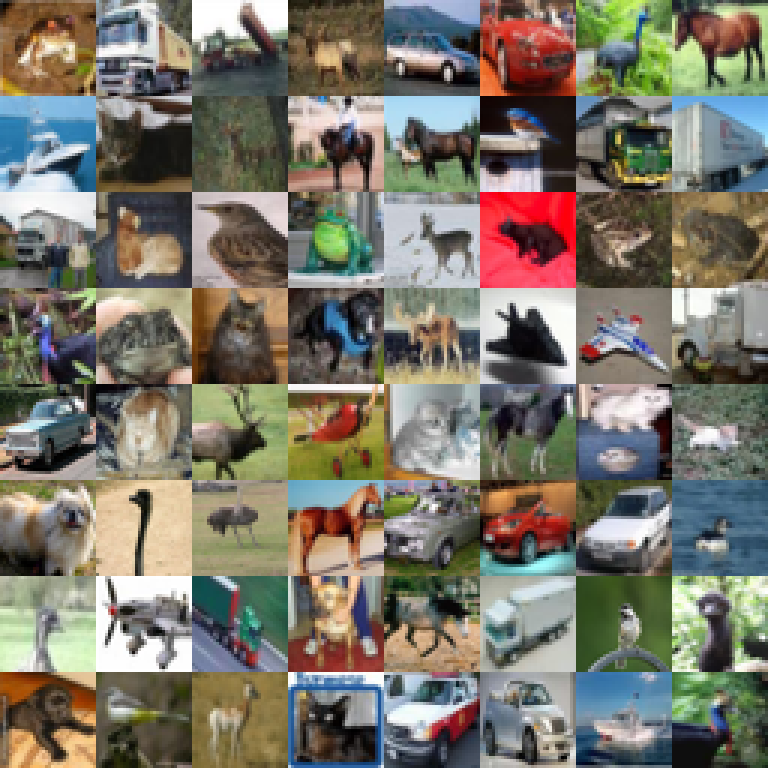
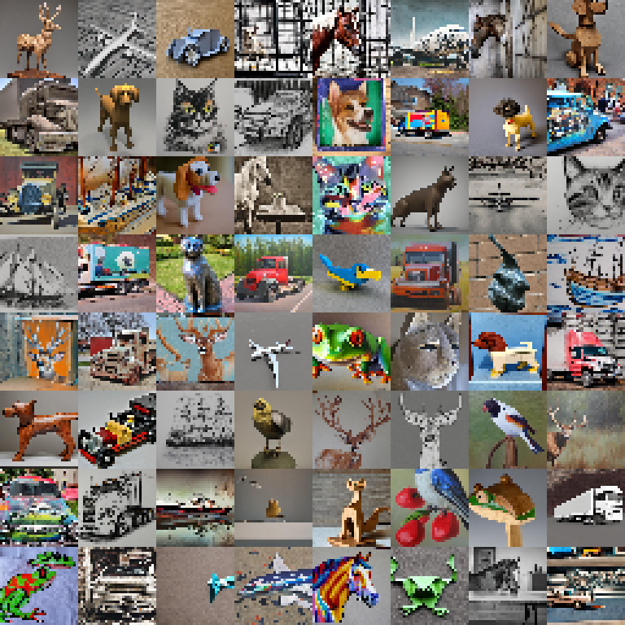

# Shifted Synthetic CIFAR-10 with Web-Scale Vision-Language Models

My solution to Assignment 3 of the [MVA RecVis](https://www.di.ens.fr/willow/teaching/recvis/) course (2026/2027). The training set is CIFAR-10 photos, and the model is evaluated on a **synthetic, distribution-shifted test domain** (toys, sketches, paintings, 3D renders, pixel art).

**Result: 98.2% on the Kaggle test**, against 46.7% for the ResNet-18 baseline.

📄 Report: [report/main.pdf](report/main.pdf)

| Train (CIFAR-10) | Test (shifted domain) |
| :---: | :---: |
|  |  |

## Approach

Fifty thousand CIFAR photos cannot teach these test styles, but web-scale vision-language models have seen them. All models are open-source [OpenCLIP](https://github.com/mlfoundations/open_clip) checkpoints.

**Inductive setting** (each test image is classified on its own):
1. **Zero-shot CLIP** with the 80 ImageNet prompt templates. Nothing is fit on CIFAR, so the models keep the robustness they get from pretraining.
2. **Ensemble** of ViT-bigG/14 (LAION-2B), ViT-H/14 (DFN-5B) and SigLIP 2 SO400M (WebLI). Their errors are complementary.

Fine-tuning on CIFAR (a linear probe or WiSE-FT) *raises* validation accuracy but *lowers* test accuracy, so the training set is used for validation only.

**Transductive setting** (uses the unlabeled test images, never their labels):
1. **kNN smoothing** over neighbouring test images and **Sinkhorn rebalancing** to a uniform class distribution.
2. **Noisy-Student distillation**: a full CLIP image encoder is fine-tuned on the test images to match the soft predictions of a fixed teacher, with RandAugment, Mixup and CutMix. Each student beats its teacher, so the process is iterated.
3. **Final ensemble** of three ViT-H/14 students (DFN, LAION-2B, MetaCLIP).

## Results

Accuracy (%) on CIFAR-10 validation and on the public Kaggle test.

| Setting | Method | Val | Kaggle |
| --- | --- | :---: | :---: |
| — | ResNet-18 baseline | 88.4 | 46.7 |
| Inductive | CLIP B/32 zero-shot | 93.6 | 89.6 |
| | CLIP bigG/14 zero-shot | 98.4 | 94.4 |
| | &nbsp;&nbsp;+ CIFAR linear probe (WiSE) | 99.1 | 93.5 |
| | Ensemble bigG + DFN + SigLIP2 | 99.0 | **95.2** |
| Transductive | Ensemble (3) + kNN + rebalancing | 99.0 | 96.4 |
| | Student ViT-L/14 + kNN + rebalancing | 95.3 | 97.1 |
| | Student ViT-H/14, strong augmentation | 96.0 | 98.0 |
| | Ensemble of 3 ViT-H students | 95.0 | **98.2** |

## Repository layout

```
clip_zeroshot.py        zero-shot CLIP classification and prompt sets
extract_features.py     extract frozen CLIP features once (resumable)
feature_experiments.py  CPU experiments on features: ensembling, WiSE, pseudo-labels, kNN, rebalancing
distill.py              Noisy-Student distillation of a CLIP encoder on test images
data.py                 dataset loading (shared)
main.py, model.py,      course starter code: ResNet-18 / ViT baseline
  main_notebook.ipynb
jobs/                   SLURM scripts used to run each GPU step
report/                 LaTeX sources and PDF of the report
```

## Reproducing

```bash
pip install -r requirements.txt   # install PyTorch first, from pytorch.org
```

Download `train.npz`, `validation.npz`, `test.npz` and `sample_submission.csv` from the course's private Kaggle competition into `data/`. Each step below writes a `submission.csv` in its output directory. Example SLURM scripts are in [jobs/](jobs/).

```bash
# 1. Frozen features for the three teacher models (GPU)
python extract_features.py --output features/bigg_laion2b    --model ViT-bigG-14               --pretrained laion2b_s39b_b160k --fp16
python extract_features.py --output features/vith_dfn5b      --model ViT-H-14-378-quickgelu    --pretrained dfn5b --fp16
python extract_features.py --output features/siglip2_so400m  --model ViT-SO400M-14-SigLIP2-378 --pretrained webli --fp16

# 2. Ensemble + kNN + rebalancing (CPU, seconds): 96.4%
python feature_experiments.py --features features/bigg_laion2b features/vith_dfn5b features/siglip2_so400m \
    --output runs/ens3_knn_bal --knn 10 --balance

# 3. First ViT-L/14 student, taught by the ensemble: 97.1%
python distill.py --teacher runs/ens3_knn_bal/test_probs.npy --output runs/distill_l14 \
    --model ViT-L-14 --pretrained laion2b_s32b_b82k --epochs 4
python feature_experiments.py --features runs/distill_l14/features --output runs/ens4_distill_knn_bal --knn 10 --balance

# 4. Second round of ViT-L/14 students, then a ViT-H/14 student with strong augmentation: 98.0%
python distill.py --teacher runs/ens4_distill_knn_bal/test_probs.npy --output runs/distill_l14_r2 \
    --model ViT-L-14 --pretrained laion2b_s32b_b82k --epochs 4
python distill.py --teacher runs/ens4_distill_knn_bal/test_probs.npy --output runs/distill_l14dfn \
    --model ViT-L-14-quickgelu --pretrained dfn2b --epochs 4
python feature_experiments.py --features runs/distill_l14_r2/features runs/distill_l14dfn/features \
    --output runs/students2_knn_bal --knn 10 --balance
python distill.py --teacher runs/students2_knn_bal/test_probs.npy --output runs/distill_h14dfn \
    --model ViT-H-14-quickgelu --pretrained dfn5b --epochs 8 \
    --grad-checkpointing --randaugment --mixup 0.8 --cutmix 1.0
python feature_experiments.py --features runs/distill_h14dfn/features --output runs/h14_knn_bal --knn 10 --balance

# 5. Two more ViT-H/14 students, then the final ensemble of three: 98.2%
for M in "ViT-H-14 laion2b_s32b_b79k h14laion" "ViT-H-14-quickgelu metaclip_fullcc h14meta"; do
    set -- $M
    python distill.py --teacher runs/h14_knn_bal/test_probs.npy --output runs/distill_$3 \
        --model $1 --pretrained $2 --epochs 8 --grad-checkpointing --randaugment --mixup 0.8 --cutmix 1.0
done
python feature_experiments.py \
    --features runs/distill_h14dfn/features runs/distill_h14laion/features runs/distill_h14meta/features \
    --output runs/vith3_knn_bal --knn 10 --balance
```

The ViT-H/14 students were trained on a single 24 GB RTX 3090 with gradient checkpointing.

## Acknowledgments

Starter code and assignment by the MVA RecVis course staff, adapted from the [2024 RecVis Assignment 3 repository](https://github.com/willowsierra/recvis24_a3). The source-domain data is [CIFAR-10](https://www.cs.toronto.edu/~kriz/cifar.html) (Krizhevsky, Nair and Hinton).
